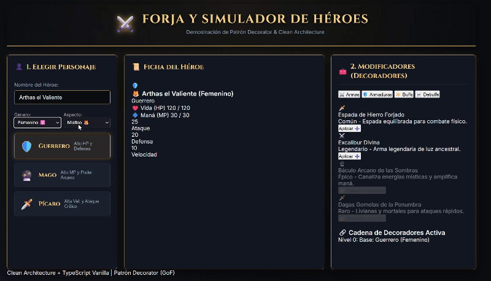
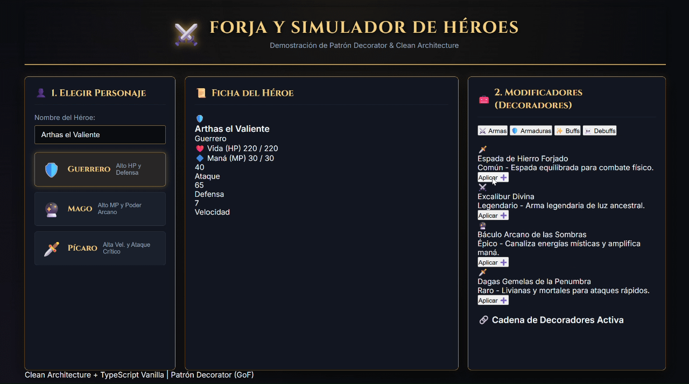

# 🛡️ Simulador de Equipamiento RPG - Arquitectura & Orquestación de IA

Este proyecto es un experimento práctico nacido con un doble objetivo: comprender conceptos avanzados de **Arquitectura de Software** (Patrones de Diseño, Clean Architecture, DDD) y aprender a **orquestar agentes de IA** en entornos de desarrollo reales.

**⚠️ Aviso de transparencia:** No he tecleado este código a mano. Mi rol en este proyecto ha sido el de **Arquitecta y Product Owner**: he definido la estructura, las reglas de negocio, he supervisado a la IA para que escribiera el código y he depurado los fallos lógicos que el modelo no fue capaz de prever.

## 🎥 Demostración Visual



## 🧠 El Stack de IA y Herramientas Utilizadas

Para construir esto, tuve que aprender a montar y gestionar un entorno de desarrollo asistido por IA:

*   **Cline (VS Code):** Utilizado como el agente autónomo encargado de redactar y modificar los archivos.
*   **Gemini API (Google):** Empecé utilizando los modelos `gemini-flash` en la nube para la planificación inicial y la estructura de carpetas.
*   **Ollama (Local):** Al chocar con los límites de peticiones de la API gratuita, configuré Ollama para ejecutar modelos en local aprovechando mi tarjeta gráfica (RTX 5070). 
*   **Optimización de Modelos (`qwen2.5-coder`):** Inicialmente probé el modelo de 14B parámetros, pero consumía mucha memoria de contexto y se "perdía" al leer múltiples archivos. Tomé la decisión de bajar al modelo `7b`, que corría mucho más rápido y fluido en mi portátil, aprendiendo a adaptar mis prompts para darle micro-tareas de un solo archivo cada vez.
*   **Gemini (Chat):** Utilizado como mi "Arquitecto Senior" de apoyo para entender los conceptos de código, auditar qué rompía el modelo local y enseñarme a escribir prompts precisos e ingenieriles para Cline.

## 🏗️ Conceptos de Arquitectura Aprendidos y Aplicados

A través de la dirección del proyecto, he puesto en práctica:

1.  **Clean Architecture:** Separación estricta entre la capa de **Dominio** (lógica TypeScript pura sin dependencias del navegador) y la capa **UI** (renderizado y eventos del DOM).
2.  **Patrón Decorator (POO):** Usado para envolver al personaje base (`Warrior`, `Mage`, `Rogue`) con capas de equipamiento y estados alterados, acumulando estadísticas de forma recursiva sin crear una explosión de clases heredadas.
3.  **Domain-Driven Design (DDD):** Implementación de reglas e invariantes de negocio estrictas.

## 🕵️‍♀️ Depuración y Reglas de Negocio (Mi aportación lógica)



Dejar a la IA programar sola el Patrón Decorator generó varios bugs críticos que tuve que detectar y mandar corregir mediante prompts específicos:

*   **El problema de los Slots Infinitos:** Inicialmente, la IA permitía equipar armas infinitas sumando estadísticas sin límite. Tuve que obligar al modelo a aplicar una regla de unicidad: *Solo 1 Arma y 1 Armadura activa*, reemplazando la capa anterior de forma limpia.
*   **Desequipado selectivo (Ruptura del LIFO):** El patrón básico de la IA solo permitía quitar la última capa (como una cebolla). Obligué a refactorizar el controlador para guardar el estado y permitir desequipar cualquier objeto intermedio recalculando toda la cadena.
*   **Restricciones de Clase:** Implementé la lógica para que las armas se bloqueen visualmente y mecánicamente si no pertenecen al arquetipo del héroe (ej. un Mago no puede usar espadas pesadas).

## 🚀 Cómo probarlo en local

El proyecto está construido con Vanilla TypeScript y Vite (sin frameworks pesados).

```bash
# Clonar el repositorio
git clone [https://github.com/RosarioGPerea/rpg-clean-architecture-demo.git](https://github.com/RosarioGPerea/rpg-clean-architecture-demo.git)

# Instalar dependencias
npm install

# Levantar el servidor de desarrollo local
npm run dev
